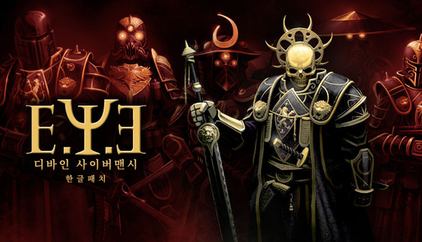
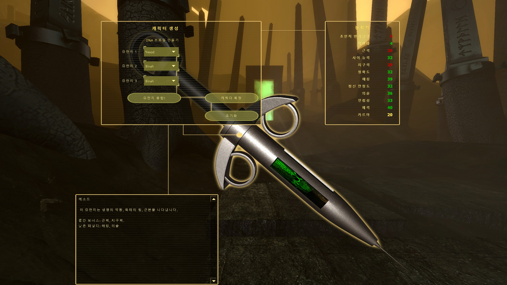
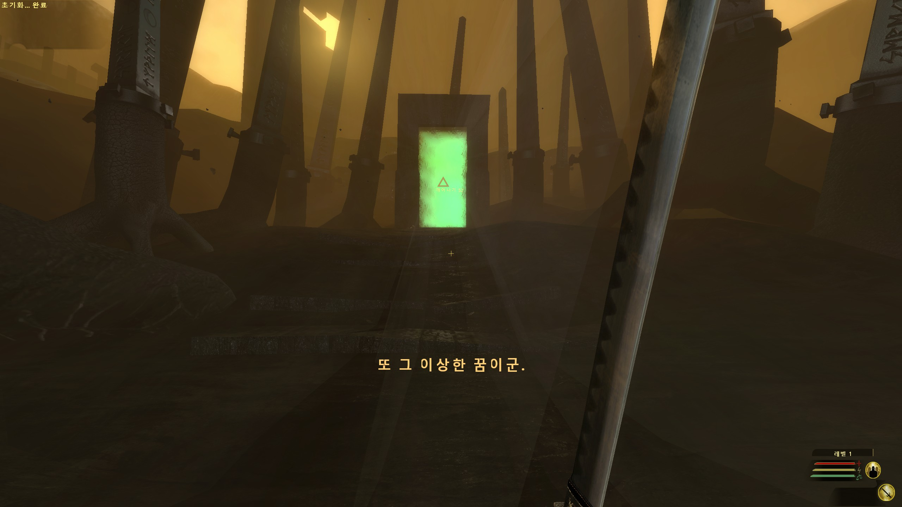
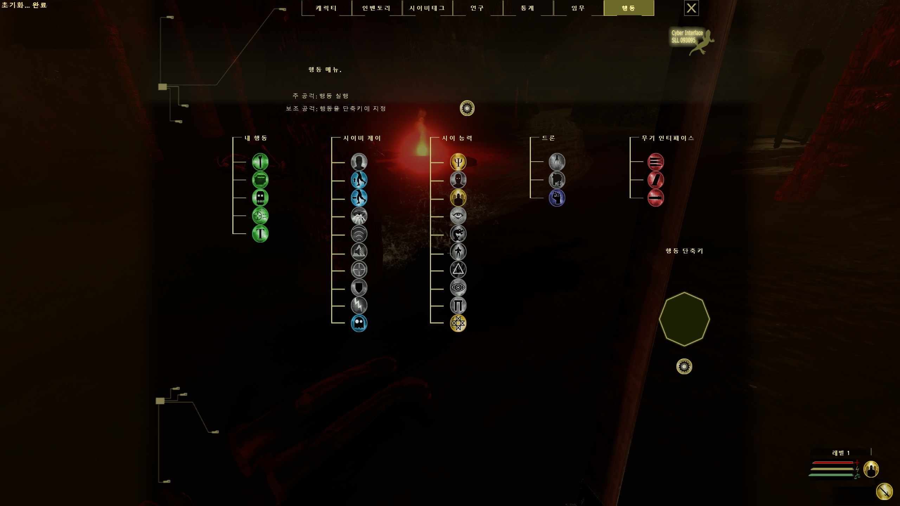
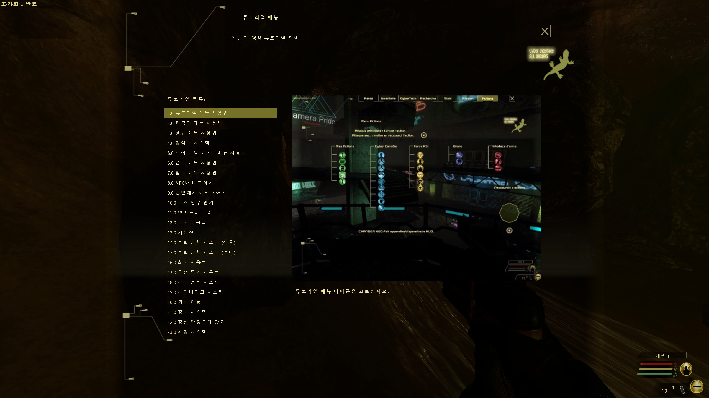

# E.Y.E: Divine Cybermancy 한글 패치



Streum On Studio의 FPS/RPG **E.Y.E: Divine Cybermancy**(Steam판)를 위한 비공식 한글 패치입니다.
메뉴와 UI 전부, 스토리 대사와 임무 목표, 로어 아카이브와 로딩 화면 문구까지 옮겼습니다.

**[⬇ 다운로드 (Releases)](../../releases/latest)** · [배포 글 (DC 인디게임 갤러리)](https://gall.dcinside.com/mgallery/board/view/?id=indiegame&no=536484)

| | |
|---|---|
|  |  |
|  |  |

## 번역 범위
- 메뉴, 설정, 키 설정, 캐릭터 생성, 장비·상점·연구·해킹 등 UI 전부
- 스토리 대사와 임무 목표 전체(약 2,900줄)
- 로어 아카이브(Eyepedia), 로딩 화면 팁과 명언
- 문자열 4,279개 중 4,149개(약 97%)가 한글입니다. 나머지는 키 이름, 고유명사, 포맷 문자열이라 원문을 그대로 뒀습니다.
- 영어 원문이 어색하거나 뜻이 모호한 곳은 프랑스어 원문과 대조해 옮겼습니다.

## 설치
1. Steam 라이브러리에서 E.Y.E를 우클릭하고 **관리 > 로컬 파일 보기**를 누릅니다.
2. [Releases](../../releases/latest)에서 받은 zip 안의 `EYE` 폴더를 그 폴더에 그대로 덮어씁니다.
   (`EYE\EYE\resource` 안의 파일이 교체되거나 추가됩니다.)
3. 게임 언어는 영어(English)로 둡니다.

되돌리려면 Steam에서 **속성 > 설치된 파일 > 게임 파일 무결성 확인**을 실행하세요.
Steam이 게임을 업데이트하면 영어로 돌아가니 다시 덮어쓰면 됩니다.

## 동작 방식 (개발자용)
E.Y.E는 Source 엔진 게임이고 한국어를 지원하지 않습니다. 이 패치는 엔진의 리소스 구조만 이용하며 실행 파일은 건드리지 않습니다.

- **텍스트:** `resource/*_english.txt`와 `resource/vgui/*/*_english.txt`(UTF-16 LE, Valve KeyValues 형식)의 값을 한글로 바꿨습니다.
  게임이 영어 언어 파일을 그대로 읽기 때문에 언어 설정을 바꿀 필요가 없습니다. `%+USE%` 같은 키 바인딩 토큰과 `\n` 줄바꿈은 그대로 유지했습니다.
- **글꼴:** 기본 글꼴에는 한글 글리프가 없어서 `ClientScheme.res`, `SourceScheme.res`, `Eye*Scheme.res`의 글꼴 정의를
  함께 배포하는 **Noto Sans KR**(`NotoSansKR-*-EYE2.otf`)로 바꿨습니다.
- **고해상도 대응 (v0.2):** 각 글꼴 정의를 `yres` 구간(~599 / 600–767 / 768–1023 / 1024–1199 / 1200+)으로 나누어
  QHD·4K에서도 글씨 크기가 해상도에 맞게 커지게 했고, 모든 한글 글꼴에 `antialias`를 켰습니다.

```
patch/
├─ EYE/resource/            ← 게임 폴더의 EYE/resource 에 덮어씀
│  ├─ *_english.txt         번역된 UI·게임 텍스트
│  ├─ vgui/*/*_english.txt  메뉴별 번역 (story_english.txt = 스토리 대사)
│  ├─ *Scheme.res           한글 글꼴·해상도별 크기 정의
│  └─ NotoSansKR-*.otf      한글 글꼴 (OFL 1.1)
├─ README_INSTALL.txt
└─ FONT_LICENSE_OFL.txt
```

## 변경 기록
- **v0.2 (2026-10-18)** 한글 글꼴을 Noto Sans KR로 교체해 작은 글씨 깨짐을 줄임, 해상도별 글씨 크기 조정, 안티앨리어싱 적용
- **v0.1** 첫 배포

## 만든 사람
- 원작: E.Y.E: Divine Cybermancy — Streum On Studio
- 번역과 리소스 작업은 Anthropic의 Claude(Claude Code, Universal Modder 플러그인)로 진행했고,
  저장소 주인이 방향을 정하고 결과를 게임에서 확인해 배포했습니다. AI 번역이라 어색한 부분이 있을 수 있습니다.

오역이나 깨지는 글자는 [Issues](../../issues)에 스크린샷과 함께 알려 주세요.

비공식 팬 패치이며 Streum On Studio와 관계가 없습니다. 게임과 원문 텍스트의 권리는 Streum On Studio에 있습니다.

## 라이선스
- 번역문: 비상업적 이용만 허용합니다. 판매를 금지합니다.
- 글꼴 `NotoSansKR-*-EYE2.otf`: SIL Open Font License 1.1 (`patch/FONT_LICENSE_OFL.txt`)
